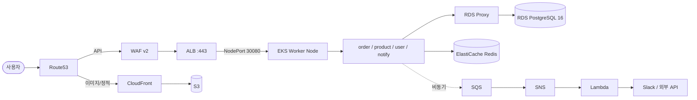

# 🥬 살리장 (Sallijang)

> **버려지던 상품을 가치 있는 소비로** — 마감 할인 상품을 연결하는 위치 기반 지역 커머스 플랫폼

위치 기반으로 소상공인의 당일 마감 재고를 소비자와 실시간으로 연결하여, 음식물 폐기와 재고 손실을 줄이는 마켓플레이스 서비스입니다. Kubernetes 기반 인프라와 DevSecOps 운영 구조 위에서 동작합니다.

> SeSAC 클라우드 DevOps 교육과정 팀 프로젝트 (3조 · 6명 · 약 4주)


---

## 📑 목차

1. [프로젝트 소개](#-프로젝트-소개)
2. [주요 기능](#-주요-기능)
3. [인프라 아키텍처](#-인프라-아키텍처)
4. [기술 스택](#-기술-스택)
5. [CI/CD & DevSecOps](#-cicd--devsecops)
6. [모니터링 / 로깅](#-모니터링--로깅)
7. [부하 테스트](#-부하-테스트)
8. [프로젝트 차별점](#-프로젝트-차별점)
9. [트러블슈팅](#-트러블슈팅)
10. [디렉토리 구조](#-디렉토리-구조)
11. [팀](#-팀)

---

## 🌱 프로젝트 소개

### 배경

고물가와 1인 가구 증가로 합리적인 가격의 상품을 찾는 소비자는 늘고 있지만, 전통시장과 소상공인 매장에서는 당일 판매되지 못한 상품이 폐기되는 문제가 반복됩니다. 소비자는 주변 할인 정보를 얻기 어렵고, 판매자는 남는 재고를 처리하지 못하는 비효율이 동시에 발생합니다.

### 해결

살리장은 위치 기반으로 주변 상점의 마감 할인 상품을 실시간으로 연결합니다. 소비자는 저렴한 가격으로 신선식품을 구매하고, 판매자는 폐기 손실을 줄이며 추가 매출을 확보할 수 있습니다.

### 서비스 가정 (초기 PoC 기준)

- 서울 일부 지역(망원·성수·잠실 등) 중심, 퇴근 시간대 트래픽 집중 가정
- 판매자 300~500명 이상 / 소비자 3,000~5,000명 규모 (EKS 기반 확장 고려)
- Auto Scaling 기반 확장성과 안정적인 실시간 할인 서비스 제공을 기술 목표로 설정

---

## ✨ 주요 기능

서비스는 도메인 중심의 마이크로서비스 아키텍처(MSA)로, 4개의 독립 서비스로 구성됩니다.

| 서비스 | 역할 |
| --- | --- |
| **User Service** | 회원가입, JWT 기반 인증, 권한 제어(Role), 찜(Wishlist) |
| **Product Service** | 상점 정보, 마감 할인 상품, AI 이미지 분석, 리뷰 집계 |
| **Order Service** | 예약 주문 상태 머신, 장바구니, 분산 트랜잭션(Redis Saga) 기반 재고 선점·차감 |
| **Notify Service** | 비동기 이벤트 수신, 실시간 브로드캐스트(SSE), 외부 알림(Slack) |

### 구매자
- 위치 기반 주변 상점·할인 상품 조회 (Kakao Map 연동, Haversine 반경 연산)
- 카테고리 필터·검색, 마감 카운트다운 기반 상품 탐색
- 예약 결제 및 현장 픽업, 카카오맵 길찾기·카카오톡 공유
- 주문 내역 관리, 리뷰 작성, 찜한 가게

### 판매자
- 마감 할인 상품 실시간 등록 (가격·수량·할인율 설정)
- **AI 이미지 분석** — 상품 사진 업로드 시 Amazon Bedrock(Claude)으로 상품명·설명·카테고리 자동 생성
- 매출 현황 대시보드, 예약 주문 관리(픽업 완료/취소), 리뷰 관리

### 공통
- 고객센터(공지/FAQ/1:1 문의), 역할별 알림 설정(Slack 연동)
- 보안 강화: httpOnly 쿠키 기반 토큰 발급으로 XSS 차단, 로그아웃 시 세션 완전 무효화

---

## 🏗 인프라 아키텍처

**AWS 기반 고가용성·보안·확장형 인프라**로, 모든 리소스는 Terraform(IaC)으로 dev/prod 환경을 분리해 관리합니다.

```
Edge (CloudFront·WAF) → ALB → Private EKS → Data 계층(다중 AZ)
```

### 전체 트래픽 흐름



### 계층별 설계

| 계층 | 구성 | 설계 의도 |
| --- | --- | --- |
| **Edge** | Route53, CloudFront, WAF v2, ACM | DNS 분기, CDN 캐싱, SQL Injection·악성 입력 차단, 전 구간 TLS |
| **Gateway** | ALB (Multi-AZ, Public Subnet) | L7 라우팅, HTTPS 종단, 단일 AZ 장애 대응 |
| **Compute** | EKS 1.29 (Self-managed ASG + Karpenter) | 상시 기반 노드 + 수요 기반 동적 확장 이중 구조 |
| **Data** | RDS PostgreSQL 16 (+ Proxy/Read Replica), ElastiCache Redis 7.0 | 커넥션 풀링, 캐시, 다중 AZ 데이터 안정성 |
| **Async** | SQS(+DLQ), SNS, Lambda | 이벤트 기반 비동기 처리로 외부 장애 격리 |
| **보안** | VPC Endpoints, IRSA, 전 구간 암호화 | 최소 권한, 프라이빗 통신, 인터넷 우회 |

### 네트워크 구조 (VPC `10.0.0.0/16`)

레이어별로 4계층(Public / EKS / Realtime / Data) 서브넷을 AZ-a, AZ-c에 대칭 배치하여 단일 AZ 장애 시에도 서비스 연속성을 보장합니다.

| 서브넷 | CIDR | 용도 |
| --- | --- | --- |
| public-a/c | 10.0.1~2.0/24 | ALB, NAT GW |
| eks-a/c | 10.0.3~4.0/24 | EKS 워커 노드 |
| realtime-a/c | 10.0.5~6.0/24 | Redis |
| data-a/c | 10.0.7~8.0/24 | RDS |

### 확장 전략 (Auto-scaling)

마감 할인 특성상 특정 시간대 트래픽이 집중되므로 2단계 자동 확장을 설계했습니다.

- **HPA** — CPU/Memory 메트릭 기준 Pod 횡적 확장(Scale-Out)
- **Karpenter** — Pending Pod 발생 시 Cluster Autoscaler보다 빠르게 최적 EC2 인스턴스를 동적 프로비저닝. `default`/`system`/`monitoring` 3-tier NodePool로 워크로드를 격리하고, Spot 인터럽션은 EventBridge → SQS → Cordon/Drain으로 선제 대응

---

## 🧰 기술 스택

| 구분 | 기술 |
| --- | --- |
| **IaC** | Terraform, Docker, Kubernetes |
| **Cloud** | VPC, EC2, EKS, Karpenter, Lambda, ECR, S3, ELB, SQS, RDS, ElastiCache, CloudFront, Route53, SNS, WAF, Bedrock, CloudWatch |
| **CI/CD** | GitHub Actions, ArgoCD, SonarQube, Trivy, GitGuardian |
| **Monitoring / Load Test** | Prometheus, Loki, Alloy, Grafana, k6 |
| **Backend** | FastAPI (Python 3.11) |
| **Frontend** | React (Vite) |
| **Collaboration** | Slack, Figma, Notion, GitHub |

---

## 🔐 CI/CD & DevSecOps

코드 변경부터 배포까지 자동화된 품질·보안 검증과 실시간 알림으로 안전한 배포를 보장합니다.

### 배포 파이프라인

```
1. 개발(Push/PR) → 2. CI 자동 검증 → 3. Slack 실시간 알림 → 4. Docker Build
→ 5. 보안 스캔 & Gate → 6. ECR Push → 7. ArgoCD Deploy
```

- **프론트엔드** — S3 + CloudFront CDN 배포. Cache-Control 분리(정적 에셋 1년 immutable / `index.html` 5분)로 정합성과 성능 동시 확보
- **백엔드** — 커밋 해시 태그로 ECR Push 후, Kustomize로 매니페스트 저장소 업데이트 → **ArgoCD Pull 기반 GitOps**로 동기화. Git 커밋 되돌리기만으로 즉시 롤백 가능
- **AWS 인증** — GitHub Secrets에 정적 키를 저장하지 않고 **IAM OIDC 기반 Keyless(STS 단기 토큰)** 인증으로 자격 증명 유출 차단

### 자동 보안 검증 체계

| 영역 | SonarQube (CI) | GitGuardian (CI) | Trivy (CI/CD) |
| --- | --- | --- | --- |
| 프론트엔드 | React 코드 품질·보안 패턴 | API Key·Secret 노출 | - |
| 백엔드 | Spring Boot/코드 보안 취약점 | 환경변수·토큰·API Key | Image·라이브러리 CVE |
| 인프라(IaC) | Workflow·코드 품질 | Terraform Secret·Credential | Terraform 보안 설정·Public IP 노출 |
| 공통 | High 이상 이슈 시 Slack 알림 | Secret·Credential 노출 | High/Critical 시 **배포 차단** |

### 실제 탐지·대응 사례

- **GitGuardian** — 소스에 하드코딩된 `KAKAO_REST_API_KEY` 자동 탐지 → 키 폐기·재발급, `.env`/GitHub Secrets 구조로 전환, CI 스캔 자동화
- **Trivy IaC** — Public Subnet의 Public IP 자동 할당을 High로 분류 → 운영 목적(ALB 수신 영역) 재검토 후 `.trivyignore`로 허용 예외 관리. 단순 차단이 아닌 운영 맥락 기반 위험도 판단 프로세스로 활용
- **Key 관리** — GitHub Secrets 수동 관리의 한계를 AWS SSM Parameter Store(자동 저장) + OIDC Keyless 구조로 개선

---

## 📊 모니터링 / 로깅

> 모니터링은 "장애 원인 추적 도구"가 아니라, 부하 테스트와 결합해 **인프라 의사결정의 근거를 제공하는 측정 체계**로 정의했습니다.

```
메트릭: Pod/Node → Prometheus(Pull) → Grafana
로그:   stdout → Alloy(DaemonSet) → Loki → S3
알림:   임계점 초과 → Alertmanager / CloudWatch → Slack
```

| 구성 | 선택 | 근거 |
| --- | --- | --- |
| 메트릭 | **kube-prometheus-stack** | ServiceMonitor CRD 기반 GitOps 친화, K8s 사실상 표준 |
| 로그 저장소 | **Loki** | 경량 리소스, Grafana 네이티브 통합, S3 백엔드 지원 |
| 로그 수집 | **Alloy** | Promtail deprecated·Fluent Bit 제약 경험 후 채택, OTLP 표준 지원 |
| 시각화 | **Grafana 단일 창** | 메트릭→로그 원클릭 연계, 다중 데이터소스 통합 |
| 스토리지 | 메트릭 EBS gp3 / 로그 S3+Glacier(계획) | 접근 패턴·보관 가치 차이에 따른 계층화 |

검증 결과 부하 증가 시 **HPA에 의한 Pod 자동 확장**과 **Karpenter에 의한 Node 자동 확장(2→3)**을 모니터링 대시보드로 확인했습니다.

---

## 🚀 부하 테스트

- **도구: k6** — Git 기반 관리, CI/CD 통합, EKS 적합성, 유지보수 안정성 (nGrinder는 archived 상태로 참고용 제한, Grafana Cloud k6는 자체 스택 운영 선택)
- **실행 전략** — 로컬 baseline → EC2 runner 기반 AWS 내부 부하 테스트(조회/주문/상품 생성·삭제/재고 차감 시나리오)
- **연계 분석** — k6 결과(p95, 에러율, TPS) ↔ Prometheus 메트릭 ↔ Loki 로그 교차 분석
- **결과** — 주문 생성 20 RPS 구간에서 API 응답 지연과 HPA/GitOps 충돌을 식별, 애플리케이션·인프라 병목 개선을 우선 수행
- **향후** — GitHub Actions 연동 smoke 성능 테스트, k6 threshold 기반 pass/fail, k6 Operator 분산 테스트 검토

---

## 💡 프로젝트 차별점

1. **개발 전 영역 자동 보안 검증** — SonarQube·GitGuardian·Trivy를 CI/CD에 내재화한 DevSecOps 체계
2. **운영 효율을 고려한 AI 설계** — Bedrock 응답 토큰 512자 제한 등 Cost Optimization 전략으로 월 AI 추론 비용 약 33% 절감
3. **Dev/Prod 환경 분리 + 부하 테스트 기반 개선** — Dev에서 실 운영 유사 조건 검증 후 Prod 반영(t3.medium → t3.large, SQS 병렬 처리)
4. **자동화된 보안 키 관리** — SSM Parameter Store + OIDC Keyless 인증으로 영구 Access Key 제거

---

## 🛠 트러블슈팅

<details>
<summary><b>서비스</b></summary>

- **분산 재고 동시성 제어** — RDBMS Row-Lock 대신 Redis 단일 스레드 기반 원자적 재고 선점 + 실패 시 보상 트랜잭션(Saga 패턴)으로 데이터 정합성 확보
- **비동기 이벤트 처리** — 동기 호출의 Cascading Failure 위험을 SQS Fire-and-Forget + SNS→Lambda 구조로 격리
- **실시간 알림 최적화** — Polling/WebSocket 오버헤드를 FastAPI SSE + Redis Pub/Sub 단방향 스트리밍으로 대체

</details>

<details>
<summary><b>인프라</b></summary>

- **S3 버킷 생성 403** — bootstrap 실행 IAM 유저에 최소 권한 정책 수동 연결
- **AWS Provider v6 deprecated** — `data.aws_region.current.name` → `.id` 일괄 치환
- **for_each Invalid argument** — 미확정 서브넷 ID 대신 고정 인덱스 Key 사용
- **kubectl logs/exec 타임아웃** — 자동 생성 cluster SG 미커버 → VPC CIDR 허용 인바운드 규칙 추가
- **Helm 클러스터 연결 실패** — EKS 생성과 kubeconfig 갱신 시점 차이 → `-target` 단계 적용으로 해결
- **IRSA 자격증명 획득 실패** — IMDSv2 환경에서 `http_put_response_hop_limit = 2` 설정

</details>

<details>
<summary><b>CI/CD</b></summary>

- **GitOps 저장소 Push 충돌** — 다수 MSA 동시 배포 시 non-fast-forward → `git pull --rebase` + 지수 백오프 재시도
- **프론트 캐시 정합성** — 파일 특성별 Cache-Control 분리 + `/index.html` 한정 무효화로 비용 절감 + 100% 정합성

</details>

<details>
<summary><b>모니터링 / 부하 테스트</b></summary>

- **임시 주문번호 Unique 충돌** — 고정 `"TEMP"` 값 제거, 요청별 unique placeholder 생성으로 order_flush 장기 대기 해소
- **HPA scale-out 원복** — ArgoCD self-heal과 충돌 → `/spec/replicas` ignore rule + `RespectIgnoreDifferences` 적용
- **k6 URL High-Cardinality** — query string별 지표 분산 → name/endpoint tag로 논리적 endpoint 단위 집계

</details>

---

## 📁 디렉토리 구조

```
modules/
├── vpc/            # 네트워크 기반 (VPC, Subnet, IGW, NAT, SG)
├── eks/            # EKS 클러스터 (ASG, OIDC)
├── rds/            # RDS Instance + RDS Proxy
├── elasticache/    # Redis Replication Group
├── alb/            # ALB + WAF + Route53
├── s3/             # 4개 버킷 + Lifecycle
├── sqs/            # Main Queue + DLQ
├── sns/            # SNS Topic + SQS Subscription
├── iam/            # IRSA Role/Policy
├── vpc-endpoints/  # VPC PrivateLink
├── cloudfront/     # CDN Distribution
└── karpenter/      # 동적 노드 프로비저닝
```

각 모듈은 단일 책임 원칙·의존성 최소화·재사용성을 기준으로 설계되었으며, `environments/dev`·`environments/prod`에서 동일 모듈을 환경별 스펙으로 호출합니다.

---

## 👥 팀

**SeSAC DevOps Team 3조** (6명) — 기획·서비스 개발·인프라·CI/CD·모니터링·부하 테스트 전 과정을 함께 설계하고 구축했습니다.

> 살리장을 통해 지역 커머스의 새로운 가능성을 열고, 안전하고 빠른 서비스를 지속적으로 제공하는 것을 목표로 했습니다.
